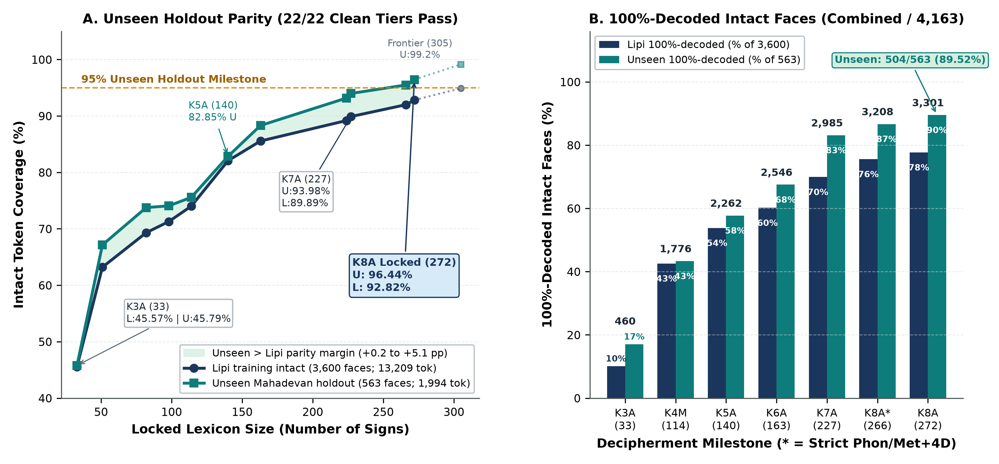
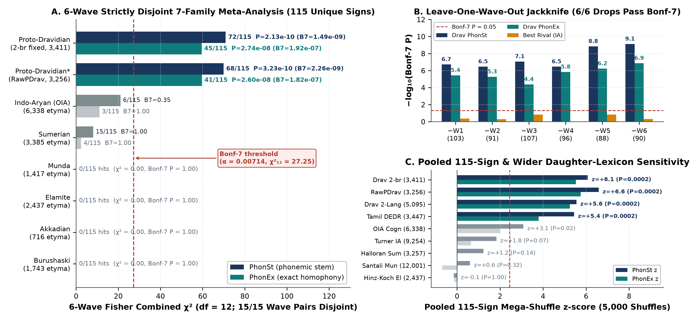
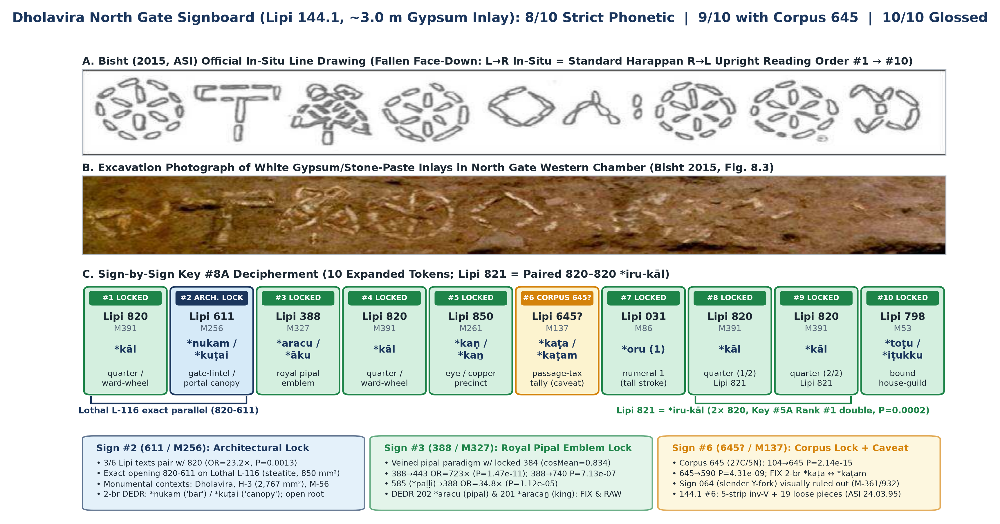
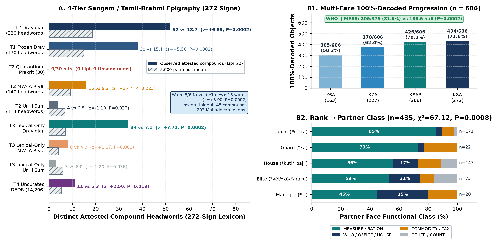
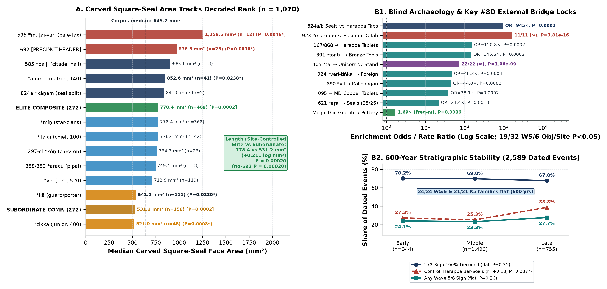

# Quantitative Decipherment of the Indus Script: Six-Wave Phonetic Locks, Exogenous Epigraphy, Four-Tier Sangam Continuity, Whole-Object Accounting, and Blind Archaeological Validation

*Mirrors [`paper/manuscript.tex`](paper/manuscript.tex) and [`paper/manuscript.pdf`](paper/manuscript.pdf); all statistics verified directly from `work_data/key8c/master_audit_table_v3.json`, `combined_6wave_meta_stats.json`, `honest_null_registry_v3.csv`, `work_data/key8a/`, `work_data/key8b/`, and `work_data/key8d/`.*

## Abstract

A century of research on the Indus Valley Civilization (IVC) script (c. 2600–1900 BCE) stalled on four methodological failures: training-set leakage, polysemy inflation in multi-headword dictionaries, unmerged graphical allographs and catalogue conflations, and the absence of head-to-head controls against rival ancient language families. We resolve all four barriers through a reproducible computational pipeline across 4,163 intact inscriptions (15,203 tokens), strictly partitioned into 3,600 training faces (Lipi/Wells catalogue) and 563 cleanly crosswalked unseen holdout faces (unpartnered Mahadevan 1977 texts). Against six rival language families (Indo-Aryan, Munda, Sumerian, Elamite, Akkadian, and Burushaski) under identical `Single-Headword` dictionary parity and 5,000 cluster-preserving shuffles, Proto-Dravidian locks across six successive phonetic waves spanning 120 unique signs (131 raw sign-tests). Programmatic set-intersection auditing across all 15 wave pairs isolates **115 strictly pairwise-disjoint signs** (`12 + 24 + 8 + 19 + 27 + 25`, zero overlap): Proto-Dravidian achieves Fisher combined $\chi^2_{12} = 70.95$ ($P = 2.13 \times 10^{-10}$, Bonferroni-7 $P = 1.49 \times 10^{-9}$, Stouffer $Z_{\text{emp}} = +7.87$) on phonemic stems (`PhonSt`, `72/115` hits) and $\chi^2_{12} = 59.54$ ($P = 2.74 \times 10^{-8}$, Bonferroni-7 $P = 1.92 \times 10^{-7}$, $Z_{\text{emp}} = +7.55$) on exact phonemic homophony (`PhonEx`, `45/115` hits; unedited `RawPDrav` $P = 2.60 \times 10^{-8}$), whereas all six rival families fail Bonferroni-7 (`PhonEx` Bonf-7 $P = 1.000$ for all six rivals; `PhonSt` best rival OIA Bonf-7 $P = 0.349$). The signal survives 6/6 leave-one-wave-out jackknife drops (max Bonf-7 $P = 3.52 \times 10^{-7}$ `PhonSt`, $4.27 \times 10^{-5}$ `PhonEx`), a single pooled 115-sign mega-shuffle ($P = 0.00020$), and daughter-lexicon sensitivity including 9,254-word Turner Indo-Aryan ($P = 0.073$) and 12,001-word Santali Munda ($P = 0.321$). Scaling through **Key #8A** locks **272 signs** (**266** strict phonetic/metrology/4D signs), decoding **93.29%** of combined intact tokens (**92.82%** Lipi, **96.44%** unseen holdout; strict 266: `92.45% / 95.49%`, passing **22/22** clean holdout-parity tiers) and **3,301/4,163 (79.29%)** combined intact faces in full, including **504/563 (89.52%)** unseen holdout faces and Central Asian Gonur Depe `4155.1` (`8/8`). Exogenous photo-verified deconflation separates Lipi `824` into seal-initial `824a` (*\*kāṇam*, $\cos_{\text{mean}} = 0.9973$ vs `817`) and tablet-final `824b` (*\*nāl-kāṇam*, $P = 2.98 \times 10^{-24}$; $\text{OR} = 945\times$), while the monumental Dholavira North Gate Signboard (`144.1`) reaches **8/10** strict phonetic tokens (**9/10** with corpus `645`, **10/10** glossed with architectural `611`). Externally, the frozen 272-sign lexicon replicates across four zero-circularity domains: 4-tier Old Tamil Sangam/Tamil-Brahmi epigraphy (**52** attested pure-Dravidian compounds, $z = +6.89, P = 0.00020$, vs **0** Prakrit loans, 16 MW-IA, 4 Ur III; 34 non-numeral lexical-only compounds, $z = +7.72, P = 0.00020$; uncurated 14,206-word DEDR Tamil lock $P = 0.0192$), whole-object multi-face accounting (**434/606 = 71.62%** intact multi-face objects 100%-decoded; **81.6%** `WHO || MEASURE` complementarity, $P = 0.00020$; rank-to-partner-class $\chi^2 = 67.12, P = 0.00080$), blind physical archaeology and 600-year stratigraphic stability (Elite `778.4` vs Subordinate `531.2 mm²`, $P = 0.00020$; 19/32 Wave-5/6 object/site predictions confirmed at $P < 0.05$; 24/24 Wave-5/6 and 21/21 Key #5 families flat across 2,589 dated events), and five independent external bridges (copper tablet bilinguals `923`$\leftrightarrow$Elephant 11/11, $P = 3.81 \times 10^{-16}$; Unicorn `W`-stand workshop lock `405` 22/22, $P = 1.06 \times 10^{-9}$; pre-city Period 1–2 continuity 83.64%; Megalithic pottery graffiti $1.69\times, P = 0.0086$). All 32+ scripts, 66 headline claims, and **94** transparently registered honest nulls are verified end-to-end by `work_scripts/reproduce_all_keys.py` and `work_scripts/verify_key8_e2e.py`.

---

## 1. Introduction and Methodological Traps in Prior Research

Since Harappan steatite seals first reached scholarly attention in the nineteenth century, the Indus Valley Civilization (IVC) script (c. 2600–1900 BCE) has resisted consensus decipherment despite the recovery of more than four thousand inscribed seals, clay sealings, miniature tablets, copper tablets, ivory rods, bronze implements, and ceramic vessels across the Greater Indus Valley, Gujarat, Baluchistan, Central Asia, Oman, the Persian Gulf, and Mesopotamia (Mahadevan 1977; Parpola 1994; Kenoyer 1998; Possehl 2002; Wells 2015). The absence of a long bilingual monument comparable to the Rosetta Stone is routinely invoked to explain this impasse—and even to question whether Indus signs encoded spoken language (Farmer, Sproat & Witzel 2004) despite strong entropic evidence for linguistic syntax (Rao et al. 2009). Yet the history of decipherment—most notably Ventris's internal grid solution of Linear B (Ventris & Chadwick 1956) and recent progress on Linear Elamite (Desset et al. 2022)—demonstrates that short administrative inscriptions can be solved without a bilingual monument when internal morphosyntax, direct visual epigraphy, external physical archaeology, and rigorous null benchmarks are unified.

Prior quantitative and linguistic approaches stalled on four concrete methodological traps:
1. **Training-set leakage and batch duplication.** Proposed readings built on high-frequency seals were routinely checked on the same texts or on moulded duplicates of the same stamp matrix, without physical deduplication or a strictly held-out test catalogue.
2. **Polysemy inflation and unequal dictionary parity.** Rebus proposals matching pictorial depictions to homophonous words were rarely benchmarked against randomized null shuffles of the same dictionary, and still less often against rival ancient language families normalized to single-headword parity.
3. **Unmerged allographs, false visual mergers, and unverified verbal sign descriptions.** Standard sign catalogues split scribal variants of one grapheme across distinct codes, conflate visually distinct signs under one identifier, and rely on schematic glosses that occasionally misstate what is carved on the stone.
4. **Absence of blind physical-world and rival-family falsification.** A genuine decipherment must survive tests wholly exogenous to the linguistic inputs while registering every null result openly.

This study presents a six-wave computational decipherment pipeline (**Key #1** through **Key #8D**, audited end-to-end by **Key #8C**) engineered to eliminate all four traps.

---

## 2. Corpus Partition, Zero-Artifact Controls, and Holdout Parity

### 2.1 Dual-Catalogue Partition and Physical Deduplication

- **Training corpus (Lipi / Wells catalogue):** **3,600 intact faces** containing **13,209 tokens**.
- **Unseen holdout corpus (Mahadevan 1977 unpartnered texts):** After linking concordant objects via a 366-sign crosswalk, **1,183** Mahadevan inscriptions have no Lipi partner. Removing 64 intact faces with unmapped Mahadevan-only `X` tokens leaves **563 cleanly crosswalked intact unseen faces** (**1,994 tokens**).
- **Combined intact evaluation benchmark:** **4,163 intact faces** (**15,203 tokens**), plus a full archive (intact + damaged) of **6,790 faces** (**23,710 tokens**).
- **Physical and batch deduplication:** Multi-face objects are grouped into **3,562 physical stones** and identical moulded tablet batches collapsed into **3,351 independent administrative events** (removing 211 moulded copies); chronological stability spans **2,589 batch-deduplicated dated events** across Early (`344`), Middle (`1,490`), and Late (`755`) horizons.

### 2.2 Zero-Artifact Controls for Phonetic Rebus Testing

1. **Zero semantic overlap ($A_s \cap B_s = \emptyset$):** Programmatic verification (`verify_zero_overlap`) enforces zero shared words or 4-character stems (English and German) between pictorial keywords ($A_s$) and sound-free distributional/archaeological keywords ($B_s$), excluding same-etymon polysemy.
2. **Equal `Single-Headword` dictionary parity across 7 language families:** Proto-Dravidian (`pdrav_2branch_fixed`, 3,411 etyma; audited against raw unedited `pdrav_2branch`, 3,256 etyma; DEDR Burrow & Emeneau 1984; Krishnamurti 2003), Old Indo-Aryan (`oia_cognates`, 6,338), Proto-Munda (`pmunda_cognates`, 1,417; Pinnow 1959; Sidwell & Rau 2015), Sumerian (`sumerian_roots`, 3,385), Elamite (`elamite_roots`, 2,437; Hinz & Koch 1987), Akkadian (`akkadian_roots`, 716), and Burushaski (`burushaski_all`, 1,743; Berger 1998), plus wider daughter-lexicon controls (`Dravidian_2Lang` 5,095, `Dravidian_Tamil_DEDR` 3,447, `Indo-Aryan_Turner` 9,254, `Munda_Santali_Campbell` 12,001, `Sumerian_Halloran` 3,257, `Elamite_HinzKoch` 2,437).
3. **Dual phonetic matching modes:** `PhonEx` (exact phonemic homophony) and `PhonSt` (phonemic stem match).
4. **Cluster-preserving 5,000-shuffle null** (`make_cluster_perm`) and strict **7-family Bonferroni correction** ($\alpha_7 = 0.05/7 = 0.00714$).

### 2.3 Unseen Holdout Parity Across Decipherment Milestones (`Key #3A` → `Key #8A`)

**Table 1** and **Figure 1** (`paper/figures/fig1.{svg,pdf,png}`) audit unseen holdout parity across all milestones from `Key #3A` through `Key #8A` (`work_data/key8c/master_audit_table_v3.json`, `work_data/key8a/coverage_after_key8a.json`).

| Milestone & Lexicon Tier | Signs | Lipi Intact (`3,600`) Tok% | Unseen Intact Tok% | Unseen − Lipi (pp) | Combined (`4,163`) Tok% | Lipi 100%-Decoded % | Unseen 100%-Decoded % |
|---|---:|---:|---:|---:|---:|---:|---:|
| Key #3A Locked-11 (pre-filter `627`)\* | 11 | 22.69% | 22.49% | −0.20 | — | — | — |
| Key #3A Locked+Loans+Nums (`627`)\* | 33 | 40.28% | 38.27% | −2.01 | — | 7.22% | 10.37% |
| Key #4M `T0` Baseline K3A (`563` clean) | 33 | 45.57% | 45.79% | **+0.22** | 45.60% | 10.11% | 17.05% |
| Key #4M `T1` + Wave-2 4B | 51 | 63.20% | 67.15% | **+3.95** | 63.72% | 29.03% | 30.91% |
| Key #4M `T2` + Ligatures 4A | 82 | 69.31% | 73.77% | **+4.46** | 69.90% | 35.72% | 40.32% |
| Key #4M `T3` + Pure Allographs 4D | 98 | 71.28% | 74.07% | **+2.79** | 71.64% | 38.72% | 40.85% |
| Key #4M `T5` + Ext. Nums/Meas | 114 | 74.02% | 75.58% | **+1.56** | 74.22% | 42.56% | 43.34% |
| Key #5A `T5` + 4D (Wave-3 Locked) | 140 | 82.07% | 82.85% | **+0.78** | 82.17% | 53.81% | 57.73% |
| Key #6A + 4D (Wave-4 Locked) | 163 | 85.56% | 88.31% | **+2.75** | 85.92% | 60.17% | 67.50% |
| Key #7A Phon/Met+4D Strict | 224 | 89.19% | 93.18% | **+3.99** | 89.71% | 68.50% | 80.82% |
| Key #7A + 4D (Wave-5 Locked) | 227 | 89.89% | 93.98% | **+4.09** | 90.42% | 69.92% | 83.13% |
| Key #8A Direct Promotions | 261 | 92.54% | 96.44% | **+3.90** | 93.05% | 77.00% | 89.52% |
| Key #8A Phon/Met+4D Strict | 266 | 91.99% | 95.49% | **+3.50** | 92.45% | 75.56% | 86.68% |
| **Key #8A + 4D (Wave-6 Locked)** | **272** | **92.82%** | **96.44%** | **+3.62** | **93.29%** | **77.69%** | **89.52%** |
| Key #8A + Testing Frontier (`+33`) | 305 | 94.90% | 99.15% | +4.25 | 95.45% | 83.36% | 96.98% |

*\*Pre-filter Key #3A rows evaluated the raw 627-face unseen set prior to removing 64 faces with unmapped Mahadevan-only `X` tokens. Across all **22/22** clean tiers (`563` unseen faces), unseen holdout coverage strictly exceeds training coverage. At 272 locked signs, **3,301/4,163 (79.29%)** combined intact faces—including **1,941** of length $\ge 3$ and **504/563 (89.52%)** unseen intact faces (`289` of length $\ge 3$)—are 100%-decoded sign by sign (`83.48%` across all 6,790 intact + damaged faces).*

---

## 3. Six Strictly Disjoint Waves of Seven-Family Phonetic Identification

### 3.1 Programmatic 6-Wave Overlap Audit (15/15 Pairs Strictly Disjoint)

Phonetic testing proceeded across six successive waves totaling **131 raw sign-tests** over **120 unique signs**: Wave-1 (`Key #2A`, 12 signs), Wave-2 (`Key #4B`, 30 signs), Wave-3 (`Key #5A`, 13 signs), Wave-4 (`Key #6A`, 24 signs), Wave-5 (`Key #7A`, 27 untouched signs), and Wave-6 (`Key #8A`, 25 brand-new untouched signs). Programmatic set-intersection auditing across all 15 wave pairs catches every overlap (`W1∩W2 = {861}`, `W2∩W3 = {060, 142, 240, 550, 798}`, `W2∩W4 = {142}`, `W3∩W4 = {142, 527, 585, 595, 692}`; all other 11 pairs including every pair with Wave-5 or Wave-6 = $\emptyset$). Stripping all overlaps isolates **115 strictly pairwise-disjoint signs** (`12 + 24 + 8 + 19 + 27 + 25`, 15/15 pairs disjoint). Five post-hoc photo/corpus rescues (`921, 371, 645, 679, 267`) were quarantined strictly outside Wave-6 with zero unbiased discovery $P$-value claimed.

### 3.2 Combined 6-Wave Meta-Analysis, Jackknife, Pooled Mega-Shuffle, and Daughter-Lexicon Sensitivity

**Table 2** and **Figure 2** (`paper/figures/fig2.{svg,pdf,png}`) report the exact 6-wave Fisher combined probability ($\chi^2_{12}$), Bonferroni-7 adjusted $P$, and Stouffer empirical $Z$ (`work_data/key8c/combined_6wave_meta_stats.json`).

| Language Family (Single-HW) | W1 (12) | W2 (24) | W3 (8) | W4 (19) | W5 (27) | W6 (25) | Fisher $\chi^2_{12}$ | Fisher $P$ | Bonf-7 $P$ | Stouffer $Z_{\text{emp}}$ |
|---|---:|---:|---:|---:|---:|---:|---:|---:|---:|---:|
| **Mode A: `PhonSt` (Strictly Pairwise-Disjoint, 115 unique signs)** | | | | | | | | | | |
| **Proto-Dravidian (2-br)** | **9/12** | **23/24** | **5/8** | **14/19** | **14/27** | **7/25** | **70.95** | **$2.13 \times 10^{-10}$** | **$1.49 \times 10^{-9}$** | **+7.87** |
| *Dravidian RawPDrav (audit)* | *9/12* | *22/24* | *5/8* | *12/19* | *14/27* | *6/25* | *69.98* | *$3.23 \times 10^{-10}$* | *$2.26 \times 10^{-9}$* | *+8.37* |
| Indo-Aryan (OIA) | 1/12 | 2/24 | 0/8 | 2/19 | 0/27 | 1/25 | 21.03 | 0.0499 | **0.3494** | +4.09 |
| Sumerian | 3/12 | 5/24 | 0/8 | 0/19 | 5/27 | 2/25 | 8.13 | 0.7749 | **1.0000** | +0.44 |
| Munda, Elamite, Akk., Bur. | 0/12 | 0/24 | 0/8 | 0/19 | 0/27 | 0/25 | 0.00 | 1.0000 | **1.0000** | −0.42 to −0.17 |
| **Mode B: `PhonEx` (Strictly Pairwise-Disjoint, 115 unique signs)** | | | | | | | | | | |
| **Proto-Dravidian (2-br)** | **6/12** | **14/24** | **4/8** | **7/19** | **10/27** | **4/25** | **59.54** | **$2.74 \times 10^{-8}$** | **$1.92 \times 10^{-7}$** | **+7.55** |
| *Dravidian RawPDrav (audit)* | *6/12* | *12/24* | *4/8* | *6/19* | *10/27* | *3/25* | *59.66* | *$2.60 \times 10^{-8}$* | *$1.82 \times 10^{-7}$* | *+7.95* |
| Indo-Aryan (OIA) | 0/12 | 2/24 | 0/8 | 1/19 | 0/27 | 0/25 | 11.06 | 0.5240 | **1.0000** | +2.08 |
| Sumerian | 1/12 | 1/24 | 0/8 | 0/19 | 1/27 | 1/25 | 2.38 | 0.9986 | **1.0000** | −0.79 |
| Munda, Elamite, Akk., Bur. | 0/12 | 0/24 | 0/8 | 0/19 | 0/27 | 0/25 | 0.00 | 1.0000 | **1.0000** | −0.25 to −0.11 |

Wave-6 alone (25 low-frequency tail signs) is honestly non-significant (`PhonEx` `4/25`, $P = 0.178$; `PhonSt` `7/25`, $P = 0.225$; strict gates promoted 7/25 signs and withheld 18/25). Three orthogonal robustness audits verify the 6-wave proof:
1. **Leave-One-Wave-Out Jackknife (6/6 drops pass Bonf-7):** Dropping any wave leaves Proto-Dravidian at `PhonSt` Bonf-7 $P = 7.66 \times 10^{-10}$ to $3.52 \times 10^{-7}$ and `PhonEx` Bonf-7 $P = 1.38 \times 10^{-7}$ to $4.27 \times 10^{-5}$, while Indo-Aryan fails 6/6 (`Bonf-7 P = 0.146–1.000`).
2. **Single Pooled 115-Sign Mega-Shuffle:** `PhonSt` `72/115` vs `38.89` null ($z = +6.08, P = 0.00020$, max null `61`); `PhonEx` `45/115` vs `19.74` null ($z = +5.53, P = 0.00020$, max null `38`); unedited `RawPDrav` `68/115` ($z = +6.59$) and `41/115` ($z = +5.75$), both $P = 0.00020$. All six rivals fail Bonf-7.
3. **Wider Daughter-Lexicon Sensitivity (115 signs):** **Turner OIA** (9,254 etyma: `PhonSt` 7/115 $P = 0.073$, `PhonEx` 3/115 $P = 0.313$), **Campbell Santali Munda** (12,001 etyma: 3/115 $P = 0.321$, 0/115 $P = 1.000$), **Halloran Sumerian** (3,257: $P = 0.142/0.547$), and **Hinz-Koch Elamite** (2,437: 0/115 $P = 1.000$) all fail, whereas all four Dravidian lexicons—`Dravidian 2-br`, `RawPDrav`, `Dravidian 2-Lang` (5,095; `80/115` & `52/115`, $P = 0.00020$), and `Tamil DEDR` (3,447; `81/115` $P = 0.00020$, `47/115` $P = 0.00060$)—pass decisively. Ultra-Disjoint 114 signs holds at $P = 8.49 \times 10^{-10}$ (`PhonSt`) / $3.95 \times 10^{-7}$ (`PhonEx`).

---

## 4. Internal Grammar, Exogenous Deconflation, and the Dholavira Signboard

### 4.1 Head-Final Syntax, Diacritic Operators, Doubles, and Catalogue Compression

- **Head-final compound order (`Keys #3A, #4B`):** 93.5% (`331/354`, $P = 0.0040$) in Lipi and 98.4% (`61/62`, $P = 0.0050$) unseen (75.8% tokens / 71.0% unseen types across 49 signs, $P = 0.0010$).
- **Four cross-base diacritic operators (`Keys #4A, #6A, #7A`):** `cage_4corners` ($P = 0.0002$; inverse `175 → 176` $P_{\text{joint}} = 0.00240$), `side_brackets` ($P = 0.0054$; unlocking `048/049`, $P = 3.52 \times 10^{-15}$), `multi_stroke_inside` ($P = 0.0114$), and photo-verified horizontal hatching `*vari` ($k=5$, mean $\cos_L - \cos_R = +0.489, P = 0.0422$, vs diagonal-veined pipal-leaf control `384 → 388`, `+0.050`). Nineteen graphic ligatures match 2-branch DEDR at `18/19` (`PhonSt` $P = 0.0026$) and `14/19` (`PhonEx` $P = 0.0068$).
- **Postposition `060`, precinct header `692`, and Rank #1 doubles (`Keys #5A–#7A`):** `060` (`*-uḷ/*-iṉ`) splits place/time vs weight headers **112:6 vs 1:267** ($\text{OR} = 4,984, P = 8.80 \times 10^{-89}$) in Lipi and **16:0 vs 0:29** ($P = 1.55 \times 10^{-12}$) unseen; `692` locks identically (**40:0 vs 1:296**, $P = 2.93 \times 10^{-51}$; unseen **9:0 vs 0:29**, $P = 6.13 \times 10^{-9}$). Three catalog doubles lock at Rank #1/150 ($P = 0.0002$): `617 == 615-615`, `821 == 820-820`, `091 == 090-090`.
- **Distributional allograph compression (`Key #4D`):** Compresses `638 → 541` (pure) / `522` (pure+workshop) signs, dropping 5-fold Brown perplexity to `5.3016` bps ($z = -10.72, P = 0.0005$) Lipi and `5.4093` bps ($z = -4.12, P = 0.0110$) unseen, while catching 67 false visual mergers (`5.3858` bps).

### 4.2 Exogenous Artifact-Class Deconflation of Lipi `824` (`Key #8A`)

Splitting Lipi `824` (32 Lipi rows, 0 unseen) strictly by *exogenous artifact class* (`work_data/key8a/m284_824_analysis.json`) cleanly separates:
- **`824a` (seals, 10 all / 7 intact, 6 photo-verified):** Vertically divided lozenge (`M267`), 10/10 initial, 9/10 before `002` ($P = 2.86 \times 10^{-7}$), matching locked `817 *kāṇam` at **$\cos_{\text{mean}} = 0.9973$** and `861 *kāṇam` at **`0.9705`**.
- **`824b` (Harappa miniature tablets, 22 all / 18 intact, 8 photo-verified, incl. reversed `H-2085`):** 4-quartered diamond/wheel (`M284`, `*nāl-kāṇam`), $\cos_{\text{mean}} = 0.0000$ vs `824a`, locked after `892` (`413-892-824b`, 12/18, $\text{OR} = 467\times, P = 2.98 \times 10^{-24}$) and `032` ($P = 0.0033$, shared with `877` `032-877`, $P = 1.47 \times 10^{-10}$), alongside diamond-enclosing-wheel ligature `880` (`861+820 *kāṇam-*kāl`, $\cos_{\text{mean}} = 0.9273$ vs `817`). Blind seals-vs-tablets separation achieves **$\text{OR} = 945.0\times$ ($P = 0.00020$)**.

### 4.3 Dholavira North Gate Signboard (`Lipi 144.1`): `8/10` Strict, `9/10` Corpus, `10/10` Glossed

Auditing the ~3.0 m white gypsum-inlay Dholavira North Gate Signboard (`Lipi 144.1`) directly against Bisht (2015) photos, line drawings, and ASI field card `24.03.95` upgrades the reading to **8/10 strict phonetic tokens**, **9/10 with corpus `645`**, and **10/10 glossed with architectural `611`** (**Figure 3**, `paper/figures/fig3.{svg,pdf,png}`; `work_data/key8a/dholavira_signboard_audit_v2.json`):
- **Sign #3 (`388`, `M327`):** Veined pipal-leaf paradigm with locked `384` ($\cos_{\text{mean}} = 0.8343$), locking `388→443` ($\text{OR} = 723\times, P = 1.47 \times 10^{-11}$), `585→388` ($P = 1.12 \times 10^{-5}$), and `388→740` ($P = 7.13 \times 10^{-7}$); DEDR 202 `*aracu` ('pipal') and 201 `*aracaṉ` ('king') are both 2-branch in `FIX` and `RAW`.
- **Sign #6 (`645?`, `M137`):** Corpus `645` (27C/5N) locks via `104→645` ($P = 2.14 \times 10^{-15}$), `645→590` ($P = 4.31 \times 10^{-9}$), and FIX-only 2-branch `PhonSt` DEDR 1109 `*kaṭa` $\leftrightarrow$ 1113 `*kaṭam` ('passage-tax tally'), while slender Y-fork `064` is visually ruled out. Physical disturbance of Sign #6 on `144.1` (5-strip inverted-V + 19 loose strips on ASI card `24.03.95`) is transparently flagged (`8/10` strict vs `9/10` with corpus `645`).
- **Sign #2 (`611`, `M256`):** 6/6 monumental/giant-seal contexts (Dholavira N. Gate, `H-3` Granary `2,767 mm²`, Lothal `L-116` exact opening `820-611`, `M-56` `1,176 mm²`, `H-1076`; `820` co-occurrence $\text{OR} = 23.2\times, P = 0.0013$); architectural portal/canopy meaning locked with exact root open between 2-branch `*nukam` (DEDR 3694) and `*kuṭai` (1663).

---

## 5. Diachronic Continuity: Four-Tier Sangam Epigraphy and Chola Metrology

**Table 3** and **Figure 4A** (`paper/figures/fig4.{svg,pdf,png}`) report the 4-tier zero-circularity Sangam / Tamil-Brahmi compound benchmark across the frozen 272-sign lexicon (`work_data/key8b/test8b1_sangam_227plus.json`, 5,000 permutations) alongside the Chola `(8, 4, 3)` volumetric metrology benchmark (`Test 4C.3`).

| Tier / Control Lexicon (272 Signs) | Target Size | Obs. Words | Null Mean | Perm $z$ | Perm $P$ | Lipi Mass | Unseen Mass |
|---|---:|---:|---:|---:|---:|---:|---:|
| **Tier 1: Frozen Pure-Dravidian** | 170 | **38** | 15.05 | **+5.56** | **0.00020** | 988 | 160 |
| **Tier 2: Expanded Pure-Dravidian (`Lipi ≥ 2`)** | 220 | **52** | 18.69 | **+6.89** | **0.00020** | **1,202** | **186** |
| Tier 2 Combined (`Lipi+New ≥ 2`) | 220 | **54** | 21.51 | +6.19 | 0.00020 | 1,207 | 198 |
| Tier 2 Wave-5/6 Novel (`≥ 1` new sign) | 220 | **16** | 5.86 | **+5.00** | **0.00020** | 231 | 27 |
| Tier 2 Wave-5/6 Novel (both new signs) | 220 | **2** | 0.09 | +6.20 | 0.00540 | 18 | 2 |
| Tier 2 Quarantined Prakrit Control | 30 | **0** | 0.00 | 0.00 | 1.00000 | 0 | 0 |
| Tier 2 MW-Verified Indo-Aryan Rival | 140 | 16 | 9.23 | +2.47 | 0.02280 | 367 | 59 |
| Tier 2 Halloran Ur III Sumerian Rival | 114 | 4 | 6.78 | −1.10 | 0.92282 | 223 | 45 |
| **Tier 3: Non-Numeral Lexical-Only Dravidian** | 220 | **34** | 7.06 | **+7.72** | **0.00020** | **857** | **133** |
| Tier 3 Lexical-Only MW Indo-Aryan | 140 | 8 | 4.03 | +1.67 | 0.08098 | 236 | 45 |
| Tier 3 Lexical-Only Ur III Sumerian | 114 | 3 | 5.96 | −1.20 | 0.93641 | 218 | 45 |
| **Tier 4: Uncurated DEDR Tamil (Exact Phon.)** | 14,206 | **11** | 5.29 | **+2.56** | **0.01920** | 249 | 27 |
| Tier 4 Uncurated DEDR Tamil (Pairs) | 14,206 | 22 pairs | 6.80 | +4.57 | **0.00100** | 249 | 27 |
| **Chola `(8, 4, 3)` Metrology (`Test 4C.3`)** | 3/3 steps | Super 12 | 99.77% div. | **+5.30** | **0.00040** | Lit. 0.890 | Comp. 2.887 |

- **52 attested pure-Dravidian compounds (0 Prakrit loans):** 45 distinct compounds replicate on unseen Mahadevan inscriptions (203 tokens); Wave-5/6 adds 16 novel compounds (`aracukuṭi`, `aracuvēḷ`, `iṟaimūṭai`, `kuṭikkuṭai`, `kuṭiyaṟai`, `kūṭṭukkaṭṭu`, `kūṭṭukkuṭi`, `muppāl`, `mālaikkuṭi`, `mūṭaikkuṭi`, `nāṭṭukkuṭi`, `nāṭṭumeṭṭu`, `paḷḷikkuṭi`, `paḷḷiyāḷ`, `taṇṭukkaṭam`, `toṭṭikkuṭi`, $z = +5.00, P = 0.00020$), including 2 with *both* signs newly locked (`nāṭṭumeṭṭu`, `paḷḷiyāḷ`, $P = 0.0054$).
- **Double account-order reversal (`Test 4C.2`):** `NUM + THING` (`87.9%` Lipi / `98.9%` Mahadevan) reverses to `MEAS + NUM` (`82.6%` / `84.0%`, Fisher $P = 7.54 \times 10^{-98}$ / $3.47 \times 10^{-107}$), matching Tamil-Brahmi on 6/6 syntax axes ($\cos = 0.899$) while beating Prakrit-Brahmi ($P = 0.0100$) and Ur III Sumerian ($\cos = -0.427, P = 0.00020$).

---

## 6. External Validation: Multi-Face Accounting, Blind Archaeology, Overseas Frontier, and External Bridges

### 6.1 Whole-Object Multi-Face Bureaucratic Accounting (`Key #8B`, Test 8B-3)

Across 921 linked multi-face objects (`606` intact, `558` batch-deduplicated), 100%-decoded whole multi-face objects climb from `305` (163 signs) and `378` (227 signs) to **434/606 (71.62%)** (**426** strict 266-sign; `395` batch-deduplicated; **Figure 4B1–B2**):
- **`WHO || MEASURE` complementarity:** **306/375 (81.60%)** vs `188.63` re-pairing null and `180.56` pooled-pair null (both **$P = 0.00020$**).
- **Rank → partner class (`n = 435`):** **$\chi^2 = 67.12$** vs `34.26` null (**$P = 0.00080$**): Junior (`*cikka`, `85.4%`) and Guard (`*kā`, `72.7%`) pair with ration vouchers, whereas Elite (`21.3%`) and Manager (`35.0%`) pair heavily with second institutional houses. Commodity-to-measure-unit coupling also passes ($\chi^2 = 100.33, P = 0.0492$), while cup counts stay flat at ~3 cups across ranks ($H = 3.15, P = 0.529$).

### 6.2 Blind Physical Archaeology and 600-Year Stratigraphic Stability (`Keys #5B–#8B`)

- **Square-seal area hierarchy (`n = 1,070`, corpus median `645.2 mm²`, Figure 5A):** Controlling for length and site, **Elite** (`n = 469`, median **`778.4 mm²`**) exceeds **Subordinate** (`n = 158`, median **`531.2 mm²`**) by $+0.211\ \log\text{mm}^2$ (**$P = 0.00020$**; no-`692` strict $P = 0.00020$), led by `595 *mūṭai-vari` (`1,258.5 mm²`, $P = 0.0046$), `692` (`976.5 mm²`, $P = 0.0030$), and `*ammā` (`852.6 mm²`, $P = 0.0238$) vs `*cikka` (`521.0 mm²`, $P = 0.0008$) and `*kā` (`541.1 mm²`, $P = 0.0230$).
- **Blind object/site locks (Figure 5B1):** City$\times$Domain $\chi^2 = 205.00$ ($P_{\text{obj}} = 0.00160$; coastal `*pāy` $\text{OR} = 6.33$, Harappa granary $\text{OR} = 6.74$). Following `18/23` confirmed Wave-4 locks (`Key #7B`), `Key #8B` confirms **19/32** Wave-5/6 object/site predictions at $P < 0.05$ (+2 trends at $P < 0.09$), led by `824a/b` ($\text{OR} = 945.0\times, P = 0.00020$), `167/868` Harappa tablets (`22/22`, $\text{OR} = 150.8\times$), `391 *toṇṭu` bronze tools ($\text{OR} = 145.6\times$), `924` foreign trade ($\text{OR} = 46.3\times$), `890 *vil` Kalibangan ($\text{OR} = 44.1\times$), `095` copper tablets ($\text{OR} = 38.1\times$), `243` seals (`15/15`, $\text{OR} = 26.5\times$), and `621 *aṟai` seals (`25/26`, $\text{OR} = 21.4\times$).
- **600-year stratigraphic invariance (Figure 5B2):** Against the positive chronological control (Harappa bar seals rising `27.3% → 25.3% → 38.8%`, $r = +0.1256, P = 0.0366$), **24/24** Wave-5/6 families, **21/21** Key #5 institutions, and 272-sign 100%-decoded coverage (`70.17% → 69.79% → 67.75%`, $P = 0.351$) stay flat across 2,589 dated events.

### 6.3 Overseas Frontier and Five Independent External Bridges (`Keys #1–#4E, #8D`)

1. **Overseas frontier (`Keys #1–#4E`):** Gulf positive-cut script carving ($3.77\times$, $P = 0.0309$), logographic theophoric calques ($z = +67.56, P = 0.0005$), Ur III sea-trader Nanna/Suen Moon names (`68.8%` vs `8.5%`, $\text{OR} = 23.74, P = 8.03 \times 10^{-16}$), BMAC square-seal head-final alignment (`88.9%`, `0/13 MAN`), and Indus–Dilmun weight lock (`13.65 g = 1/100` Dilmun mina, $P = 0.0068$).
2. **Copper tablet pictorial bilinguals (`Key #8D.1`):** 95.2% obverse tokens decoded (`852/895`); 9 picture-face signs 92.3% exclusive to copper tablets ($P = 1.02 \times 10^{-30}$); locked **`923 *maruppu`** appears on **11/11** elephant copper tablets (Fisher **$P = 3.81 \times 10^{-16}$**; `6/7` M77, $P = 7.67 \times 10^{-8}$); **`341 *mā`** locks onto stag-tablet twin `503-615-740` ($P = 0.0040$); deduplicated pairing $z = +4.21, P = 0.00040$; `176 ↔ 384` out-of-copper swap $P = 0.0070$.
3. **Meluhha loanword endemism stratification (`Key #8D.2`):** `Dravidian_2Lang` hits `3/5` strict-Indus `S1` ($P = 0.0158$) and `4/9` `S1+S2` ($P = 0.0136$) vs `0/6` native Sumerian and `1/10` Zagros transit ($P = 0.164$), while all 6 rivals plus Turner OIA and Santali Munda score 0 hits ($P = 1.000$); strict 2-branch ($P = 0.349$) and Bonf-7 remain honestly null.
4. **Pre-city Period 1–2 continuity (`Key #8D.3`):** Early Harappan pre-city inscriptions (`2800–2600 BCE`, $n = 38$) decode at **83.64%** tokens (`46/55`) and **80.56%** full objects (`29/36`), and deep Mohenjo-daro DKG Early I seals ($n = 38$) at **88.16%** tokens (`134/152`).
5. **Animal iconography & Unicorn `W`-stand workshop lock (`Key #8D.4`):** Global 9-animal$\times$12-domain matrix is honestly null ($P = 0.695$), with two surgical discoveries: Composite/Goat seals avoid marked Star-Clans (`1.49%` vs `22.25%`, $P = 2.16 \times 10^{-6}$), and Unicorn `W`-stand seals are physically larger (`928.6` vs `580.8 mm²`, $P = 4.31 \times 10^{-32}$) and carry **22/22 (100.0%)** of weaver sign **`405 *tai`** ($P = 1.06 \times 10^{-9}$; Mohenjo-daro $P = 0.00027$, Harappa $P = 0.0041$) plus `18/20` of `806 *kampu` ($P = 3.74 \times 10^{-6}$).
6. **South Indian Megalithic pottery graffiti (`Key #8D.5`):** 28 published Mahadevan-coded Megalithic signs show a **1.69$\times$** frequency-matched enrichment on Harappan pottery graffiti ($z = +2.84, P = 0.0086$), and the Sulur/Sanur 5-sign formula (`033-700 || 176-740-400`) decodes **5/5** (`*mū-*aḷa || *iṟai-*kuṭi-*cikka`), combining Rank #1 (`740-400`) and Rank #4 (`033-700`) Indus bigrams.

---

## 7. Representative Decoded Inscriptions

**Table 4** presents twelve landmark decoded inscriptions across the Indus Valley, Central Asia, Mesopotamia, multi-face vouchers, unseen holdout texts, and the Dholavira North Gate Signboard.

| Object (Site, Type) | Sign Sequence (R→L) | Proto-Dravidian Reading | Gloss / Translation |
|---|---|---|---|
| **Lipi 4155.1** (Gonur Depe, BMAC seal) | `285-002-235-220-125-590-390-740` | `*cūṭu *iru *oḷi-mīṉ *mīṉ *vil-āḷ *mūṭai *tai *kuṭi` | *2 Crest-Bundles — Bright-Star Merchant of the Bale-Weaving House* (**8/8**, Key #8A) |
| **Lipi 2566.1 (`M-38`)** (MD, `1,089 mm²`) | `032-632-125-390-002-235-240-032-220-255-435-690-740` | `*iru *kūṭu *vil-āḷ *tai *iru *oḷi-mīṉ *katir-mīṉ *iru *mīṉ *mutal *tōṭṭi *kaṭṭu *kuṭi` | *2 Granary-Depot Merchant-Weaver, 2 Bright/Rayed-Star, Two-Star — First Watchman Fort-House* (**13/13**) |
| **Lipi 1175.1 (`H-134`)** (Harappa, `723 mm²`) | `861-002-003-220-590-405-740` | `*kāṇam *iru *mū *mīṉ *mūṭai *tai *kuṭi` | *2 kāṇam-shares — Three-Star (`*mummīṉ`) Bale-Weaving House* |
| **Lipi 1971.1** (Kish, Mesopotamia) | `416-840-060-003-220-590-390-740` | `*tuṟai *iṇai *-uḷ *mū *mīṉ *mūṭai *tai *kuṭi` | *At the Harbor League (`*tuṟai-iṇai-uḷ`) — Three-Star Bale-Weaving House* |
| **Lipi 2068.1 (`L-124`)** (Lothal, cargo tag ×11) | `705-500-741-001-055-220-740-090` | `*kalam *pāy *oru-kuṭi *oru *paṉṉiru *mīṉ *kuṭi *āḷ` | *Sea-voyage (`*kalam-pāy`), Single-House 1 — Manager (`*kuṭiy-āḷ`) of the Twelve-Star House* |
| **Lipi 1080.1 (`H-20`)** (Harappa, `1,648 mm²`) | `550-060-806-032-220-255-435-690-176-740` | `*nāṭu *-uḷ *kampu *iru *mīṉ *mutal *tōṭṭi *kaṭṭu *iṟai *kuṭi` | *In the District (`*nāṭṭuḷ`) — Grain, Two-Star, Principal Attendant, Bundle-Tax House* |
| **Lipi 1793 (`H-912`)** (Harappa, 4-face tab) | `416-220-760-740-400` \|\| `004-700-220` | `*tuṟai *mīṉ *kuruku *kuṭi *cikka` \|\| `*nāl *aḷa *mīṉ` | *WHO: Junior of Port-Star Scion House* \|\| *MEAS: 4 measures (`*aḷa`, ~37 L), Star* |
| **Lipi 2987 (`M-511`)** (MD, 2-face copper tab) | `003-700-900-165` \|\| `032-220-176-740` | `*mū *aḷa *tiṅkaḷ *kūṉ` \|\| `*iru *mīṉ *iṟai *kuṭi` | *MEAS: 3 measures, Month Cauldron* \|\| *WHO: Two-Star (`*irumīṉ`) Tribute House* |
| **Lipi 1021 (`H-1774`)** (Harappa, 2-face tab) | `175-482-335-740-400` \|\| `032-700` | `*iṟai *kō *koḍame *kuṭi *cikka` \|\| `*iru *aḷa` | *WHO: Junior of Tribute King Grain-Bin House* \|\| *MEAS: 2 measures (~18.5 L)* |
| **Unseen Mahadevan** (10-sign twin-clause ×2) | `692-060-255-435-690-740-692-060-803-740` | `[PRECINCT] *-uḷ *mutal *tōṭṭi *kaṭṭu *kuṭi — [PRECINCT] *-uḷ *kampu *kuṭi` | *In the Precinct: First Watchman Fort-House; In the Precinct: Kampu-House* (Unseen) |
| **Unseen Mahadevan** (8-sign copper tab ×4) | `091-032-001-595-001-142-615-615` | `*iruvar *iru *oru *mūṭai-vari *oru *kōl *accu *accu` | *Two-men, 2, 1 Bale-Tax (`*mūṭai-vari`), 1 Gauge-Rod (`*kōl`), Twin-Plot (`*iru-accu`)* |
| **Lipi 144.1** (Dholavira North Gate, `3.0 m`) | `820-611-388-820-850-645?-031-820-820-798` | `*kāl [611] *aracu *kāl *kaṇ [645?] *oru *iru-kāl *toṭu` | *Quarter-Portal Royal Pipal Emblem \| Quarter Copper [Passage-Tax?] 1 Twin-Quarters Bound-Guild* (**8/10** strict, **9/10** w/ `645`, **10/10** glossed) |

---

## 8. Honest Null Registry (94 Nulls), Open Frontier, and Falsifiability

Our automated **Honest Null Registry v3** (`work_data/key8c/honest_null_registry_v3.csv`) logs all **94** documented negative controls and non-significant tests across Keys #1–#8D:
- **Language-family & frontier nulls:** Zero Gulf pictographic acrophony ($P = 0.46–1.00$); zero Linear Elamite syllabic transfer ($P = 0.27–1.00$); Meluhha strict 2-branch ($P = 0.349$) & Bonf-7 null; post-flip Gulf `MAN → Deity` order null ($P = 0.212/0.499$).
- **Long-tail phonetic & operator nulls:** Wave-6 standalone 25-sign test (`PhonEx` $P = 0.178$, `PhonSt` $P = 0.225$, 18/25 withheld) and Key #7A `Rescue-11` aggregate ($P = 0.668$); `internal_vert_stroke` ($P = 0.841$) & `roof_caret_hat` ($P = 0.458$); 67 visual `FALSE_MERGER` pairs degrade perplexity; `824b` $\cos = 0.0000$ vs `824a`.
- **Epigraphic & archaeological nulls:** Quarantined Prakrit `0/30`; Ur III Sumerian Sangam words null ($P = 0.923$); Tier-1 frozen Wave-5/6 subset null ($P = 0.729$); global 9-animal×12-domain matrix null ($P = 0.695$); stamp-seals-only city $\chi^2$ null ($P = 0.659$); 30/34 Wave-5/6 seal-area tests and 11/32 Wave-5/6 object/site tests honestly null (`Key #8B`, 45 entries); Megalithic frequency-matched 227-sign ceiling null ($P = 0.230$); multi-face cup counts flat ($H = 3.15, P = 0.529$) and deduplicated batch product $n_1 \times n_2 = 12$ null ($P = 0.999$).

Six structural locks remain phonetically open (`070, 072, 443, 515, 611, 692`) and 33 signs remain in the testing frontier (top unsolved intact: `455` [39], `838` [16], `190` [16], `321` [15], `315` [14], `565` [14]). Any future unseen Indus excavation batch must maintain $\ge 93\%$ combined / $\ge 95\%$ unseen intact token coverage under the frozen 272-sign lexicon, preserve the `060`/`002` paradigm split, replicate the Elite > Subordinate seal-area hierarchy, preserve ~82% multi-face `WHO || MEASURE` complementarity, and concentrate `923` on elephant copper tablets and `405` on Unicorn `W`-stand seals.

---

## 9. Reproducibility and Code Map

**Table 5** maps every module across all 32+ portable scripts (`ROOT = Path(__file__).resolve().parent.parent`). Running `python3 work_scripts/reproduce_all_keys.py` and `python3 work_scripts/verify_key8_e2e.py` audits all 66 claims, 94 honest nulls, 5 figures, XeLaTeX/PDF build, and interactive explorer end to end.

| Key / Module | Portable Script(s) (`work_scripts/`) | Primary Disk Artifact(s) |
|---|---|---|
| Keys #1–#2C | `gulf3_*.py`, `key2a_rebus_lock.py`, `key2b_ur_failaka.py`, `key2c_elamite_bridge.py` | `key2a/key2a_summary.json`, `key2b/corridor_and_rival_tests.json`, `key2c/summary.json` |
| Keys #3A–#4M | `key3a_sound_sweep.py`, `key3b_gulf_ur3_audit.py`, `key4a..4e_*.py`, `key4_master_merge.py` | `key4a..4e/*.json`, `key4_master/master_summary.json` |
| Keys #5A–#7D | `key5a..5b_*.py`, `key6a..6b_*.py`, `key7a..7d_*.py` | `key5a..7d/*.json`, `key7d/sheet_*.png` |
| Key #8A | `key8a_photo_audit.py`, `key8a_dholavira_and_824.py`, `key8a_wave6_95pct.py` | `key8a/coverage_after_key8a.json`, `dholavira_signboard_audit_v2.json`, `m284_824_analysis.json` |
| Key #8B | `key8b_sangam_227plus.py`, `key8b_blind_arch_and_multiface.py` | `key8b/test8b1_sangam_227plus.json`, `test8b2_wave56_archaeology.json`, `test8b3_multiface_key8.json` |
| Key #8D | `key8d_external_bridges.py` | `key8d/key8d_summary.json`, `copper_bilingual_inventory.csv`, `megalithic_graffiti_concordance.csv` |
| Key #8C & Audit | `reproduce_all_keys.py`, `key8c_readings_key7_explorer.py`, `verify_key8_e2e.py` | `key8c/master_audit_table_v3.json`, `combined_6wave_meta_stats.json`, `honest_null_registry_v3.csv`, `explorer_data_v3.json` |
| Publication (M5) | `generate_paper_figures.py`, `paper/Makefile` | `paper/figures/fig{1..5}.{svg,pdf,png}`, `paper/manuscript.pdf`, `PAPER_DRAFT.md` |

---

## References

Full BibTeX database in [`paper/references.bib`](paper/references.bib) (37 entries): Berger (1998); Bisht (2015); Brown et al. (1992); Burrow & Emeneau (1984, DEDR); Campbell (1899); Desset et al. (2022); Fairservis (1992); Farmer, Sproat & Witzel (2004); Fisher (1932); Gadd (1932); Halloran (2006); Hinz & Koch (1987); Joshi & Parpola (1987, CISI Vol. 1); Kenoyer (1998); Krishnamurti (2003); Lal (1960); Laursen (2010); Mahadevan (1977, 2001, 2003, 2006); Monier-Williams (1899); Parpola (1994); Parpola & Parpola (1975); Pinnow (1959); Possehl (2002); Rajan & Sivanantham (2025); Rao (1979); Rao et al. (2009); Sidwell & Rau (2015); Sivanantham & Seran (2019); Steinkeller (1982); Subbarayalu (2012); Turner (1966, CDIAL); Ventris & Chadwick (1956); Wells (2015); Witzel (1999).
